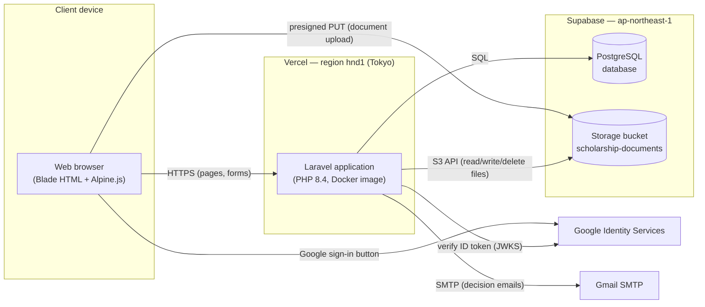
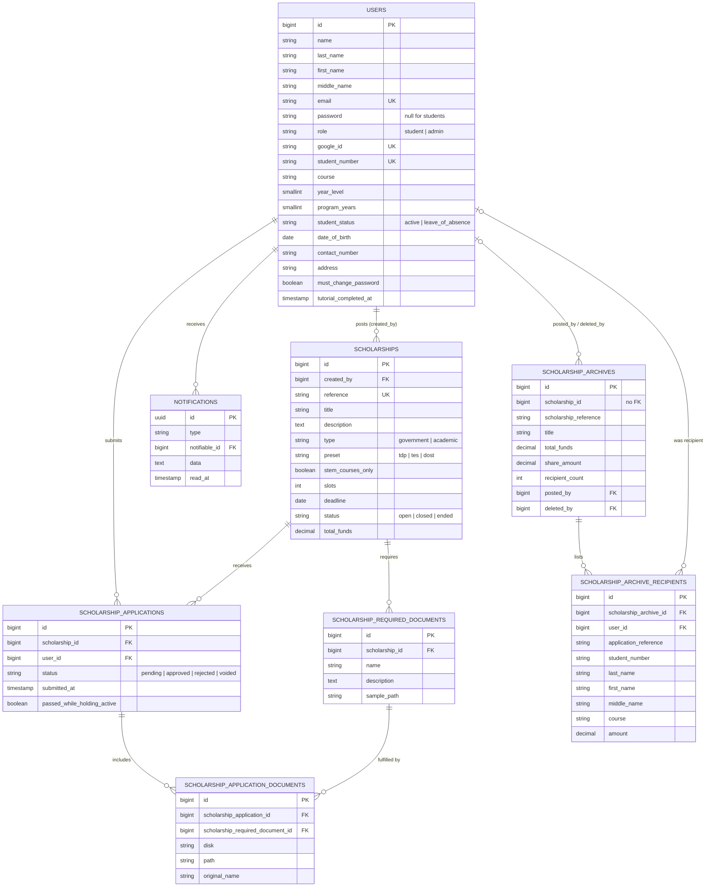
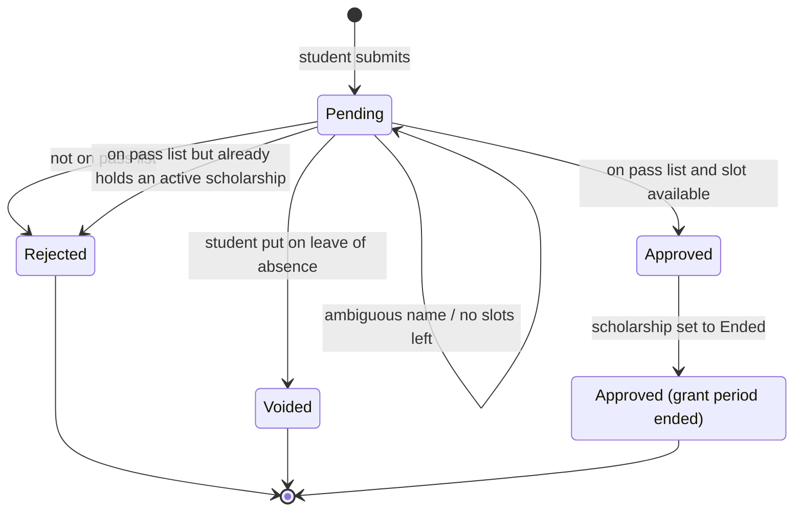
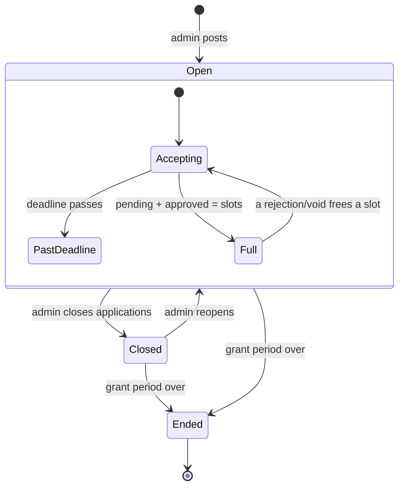
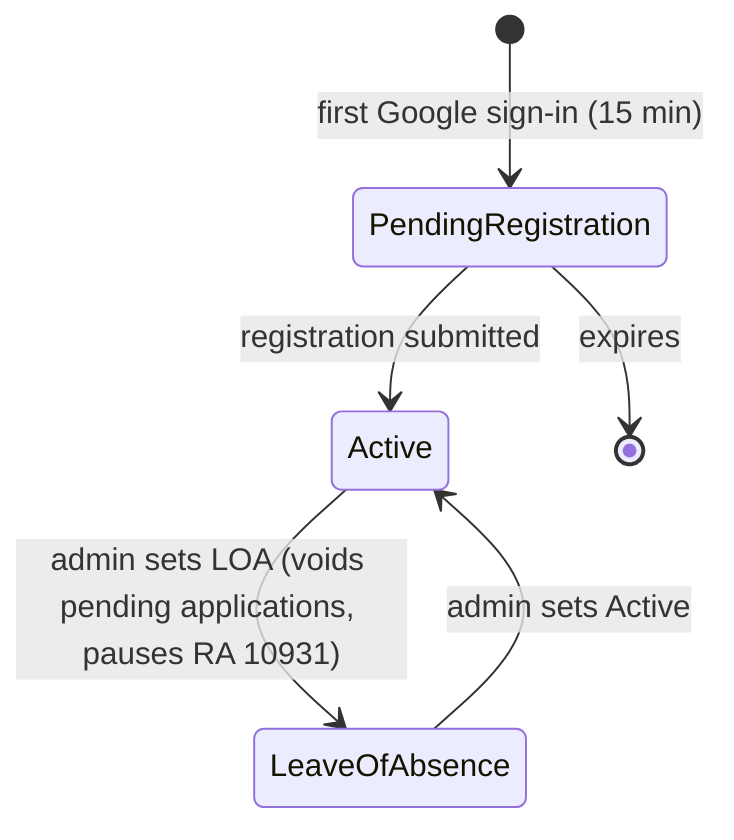
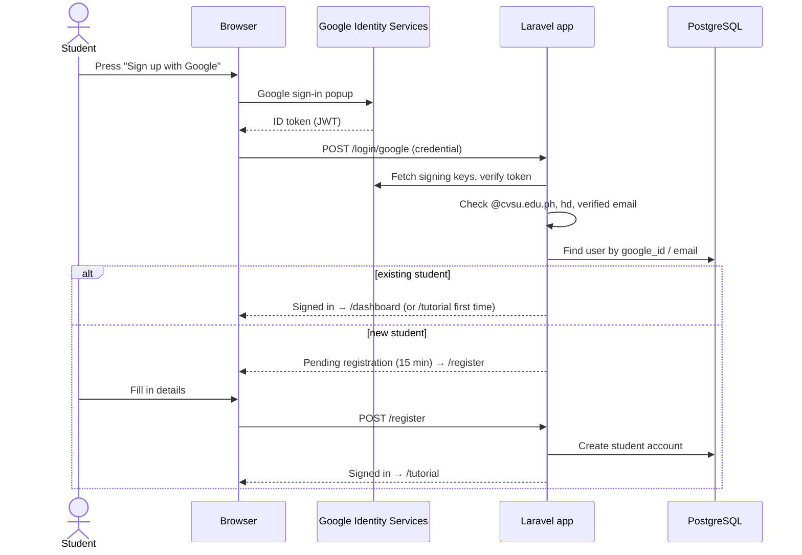
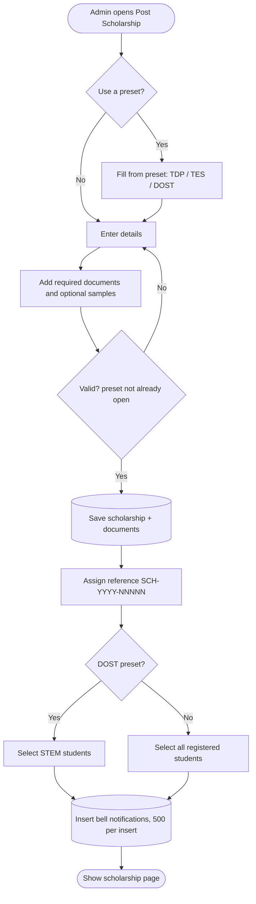
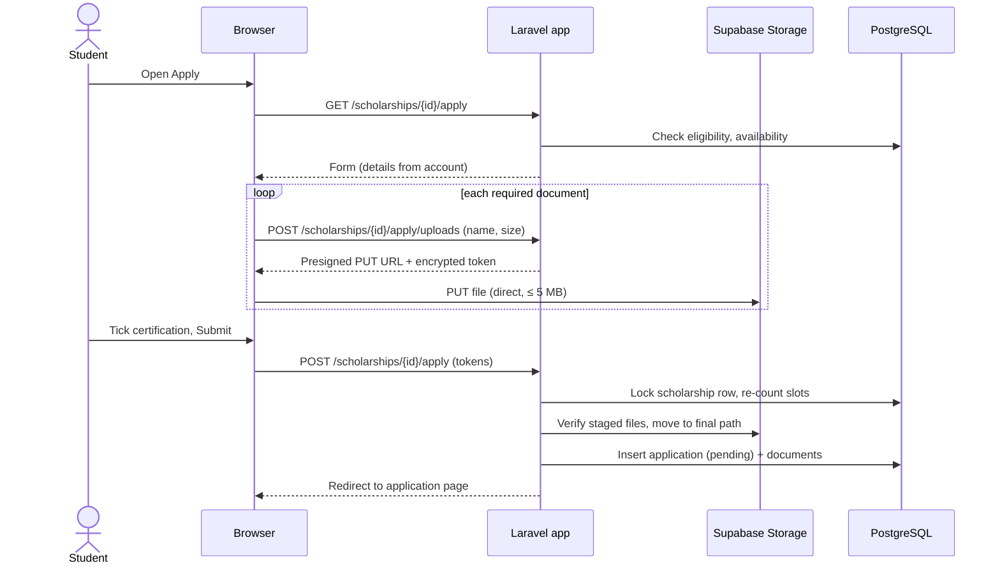
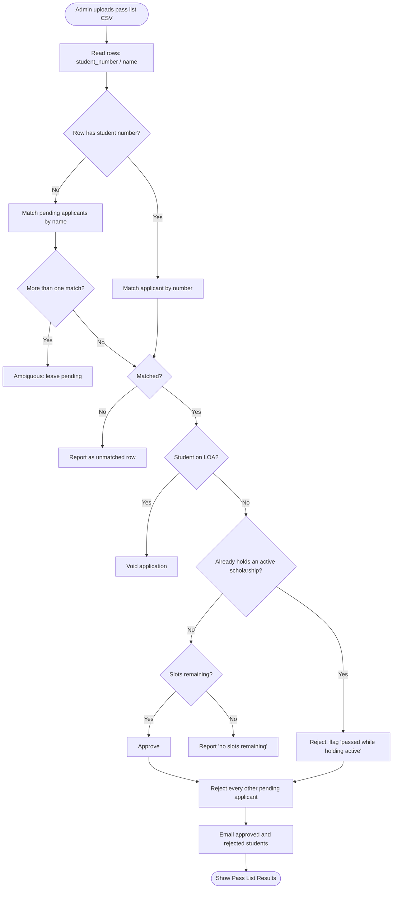
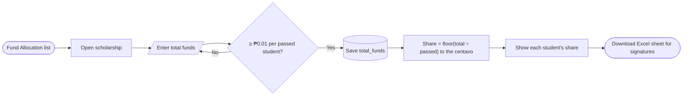

# OSAS Scholarship Allocation System — System Documentation

**Cavite State University (CvSU) Main Campus, Indang, Cavite — Office of Student Affairs and Services (OSAS)**
Prepared from the source code on October 25, 2026, for use as the input to system diagrams.

> **How to use this document.** Every section is self-contained. To draw a diagram, paste the section it
> names (and §1–§2 for context) into your diagram prompt. Ready-made prompts are in **§14**. The Mermaid
> blocks can be pasted straight into any Mermaid renderer (GitHub, draw.io → Arrange → Insert → Mermaid,
> mermaid.live).

| Diagram you need | Use these sections |
| --- | --- |
| Use case diagram | §2 Actors, §5 Use cases |
| Entity Relationship Diagram (ERD) / database schema | §7 Data model |
| Context diagram / Data Flow Diagram (DFD Level 0, 1) | §2, §10 |
| Flowcharts / activity diagrams | §9 Process flows |
| Sequence diagrams | §9 (each flow lists its messages) |
| State (statechart) diagrams | §8 State models |
| System architecture / deployment diagram | §3 Architecture |
| Class diagram | §7 (models) + §6 (rules as methods) |
| Site map / navigation diagram | §4 Modules |

---

## 1. System overview

**Name:** OSAS Scholarship Allocation System (web application).

**Purpose:** Digitizes the Main Campus scholarship cycle end to end, replacing a paper process. OSAS posts a
scholarship with its slots, deadline and required documents; eligible students are notified; students apply
and upload their documents; OSAS decides the whole cohort at once by uploading a **pass list**; approved and
rejected applicants are emailed; OSAS then splits the scholarship's **total funds** equally among the students
who passed and downloads an Excel sheet that the students sign when paid.

**Standing:** Deployed and in a pilot with Main Campus OSAS; not yet the office's official process.

**Scope:** One campus (Main Campus), two roles (**Student**, **OSAS Admin**), the undergraduate programs of the
CvSU colleges (CAFENR, CAS, CCJ, CEMDS, CED, CEIT, CON and the rest).

**What makes it specific to this office (not a generic form builder):**
- Slots are enforced against pending + approved applications.
- A student may have at most **2** applications at a time and hold at most **1** active scholarship.
- A posting from a **preset** (TDP, TES, DOST) may be held once per student.
- Free tuition under **Republic Act No. 10931** is computed from the student number and program length.
- Decisions are made only by **pass list** (CSV), mirroring how OSAS already publishes results.

---

## 2. Actors (users and external systems)

### Human actors
| Actor | Who | How they sign in |
| --- | --- | --- |
| **Student** | A CvSU undergraduate | **Sign in with Google**, @cvsu.edu.ph accounts only. No password. |
| **OSAS Admin** (Administrator / staff) | OSAS office staff | Email + password. Accounts are created by a developer with `php artisan users:create`; the first sign-in forces a password change. |
| *(Developer / System Maintainer)* | Whoever deploys the system | Runs console commands (`users:create`, `uploads:prune-staged`, `db:seed`). Not a web user. |

### External systems (secondary actors)
| System | Role |
| --- | --- |
| **Google Identity Services** | Issues the signed ID token for student sign-in; the server verifies it (signature, audience, issuer, expiry, verified email, `hd = cvsu.edu.ph`). |
| **Gmail SMTP** | Sends decision emails (approved / rejected), one message per student. About 500 recipients a day on a free account. |
| **Supabase PostgreSQL** (`ap-northeast-1`) | The database. |
| **Supabase Storage** (`ap-northeast-1`, bucket `scholarship-documents`) | Stores applicants' uploaded documents, sample documents, and generated PDF reports. |
| **Vercel** (region `hnd1`, Tokyo) | Hosts the web application (Docker image, PHP). |

---

## 3. Architecture and technology

| Layer | Technology |
| --- | --- |
| Language / framework | PHP 8.4, **Laravel** (MVC) |
| Views | **Blade** templates, **Tailwind CSS**, **Alpine.js** (small client-side behaviour) |
| Database | **PostgreSQL** on Supabase (SQLite for local development) |
| File storage | **Supabase Storage** (S3-compatible), disk name `supabase`; `local` in development |
| Authentication | Laravel session auth; Google ID-token verification for students |
| Email | SMTP (Gmail), sent synchronously inside the request |
| PDF | dompdf (report pages) + **qpdf** (joins the parts) |
| Excel | Hand-built `.xlsx` (Office Open XML) in `App\Support\FundAllocationSheet` |
| Hosting | **Vercel** (`hnd1`), Docker image built from `Dockerfile.vercel` |

**Architectural constraints (good to show on the deployment diagram):**
- **No queue worker and no scheduler** on Vercel: all work (mail, notifications, decisions) runs inside the web request.
- Vercel refuses request bodies over **4.5 MB**, so students' files go **directly from the browser to Supabase Storage**
  through a **presigned PUT URL** (a "staged upload"); the application form then carries only an encrypted upload token.
- Each database round trip costs about **240 ms** (Vercel Tokyo ↔ Supabase Tokyo), so pages are written to use few queries.
- The PDF applications report is built **step by step**, driven by the browser, with progress kept in the cache table.

**Deployment (for a deployment diagram):**

---

## 4. Modules and pages (site map)

### 4.1 Public / authentication
| Page | Route | Notes |
| --- | --- | --- |
| Sign in | `GET /login` | Password form (staff) + **Sign up with Google** (students). Shows test accounts only on a local machine. |
| Google sign-in | `POST /login/google` | Receives the Google ID token. |
| Student registration | `GET/POST /register` | Only during a 15-minute pending registration after a first Google sign-in. |
| Forgot / reset password | `/forgot-password`, `/reset-password/{token}` | Staff only. |
| Forced password change | `GET /password/change`, `PUT /password` | Staff whose `must_change_password` is true. |
| Email verification | `/verify-email…` | Laravel default. |
| Sign out | `POST /logout` | |

### 4.2 Student modules
| Module | Route | What it shows / does |
| --- | --- | --- |
| **Dashboard** | `GET /dashboard` | Welcome banner with status line and **notification bell**; *Where you stand* (ID box, RA 10931 box, active scholarship); *Available to apply* boxes; *My applications*. |
| **Scholarships** | `GET /scholarships` | Every scholarship open to the student, beside where they stand. |
| Scholarship details | `GET /scholarships/{scholarship}` | Description, required documents with sample previews, restriction reasons, Apply button. |
| Sample document | `GET …/required-documents/{doc}/sample[/download]` | Preview / download the sample OSAS attached. |
| **Apply** | `GET/POST /scholarships/{scholarship}/apply`, `POST …/apply/uploads` | Details pre-filled from the account; upload each required document (JPG/PNG/PDF ≤ 5 MB); certify; submit. |
| **My Applications** | `GET /scholarship-applications` | One card per application (reference, applied date, status, days waiting). |
| Application details | `GET /scholarship-applications/{application}` | Post → Apply → Review → Decide register; documents sent (download). |
| Republic Act 10931 | `GET /scholarships/republic-act-10931` | What free tuition means for the student + the full text of the Act. |
| Notifications | `POST /notifications/{id}/read`, `POST /notifications/read` | Open one (marks read, opens the scholarship) / mark all as read. |
| **Profile** | `GET/PATCH /profile` | Edit last, first, middle name, date of birth, contact number, address. Email, student number, course, year level are read-only (kept by OSAS). |
| **Tutorial** | `GET /tutorial`, `POST /tutorial/complete` | Practice tour on sample screens; opens automatically on the first visit. |

### 4.3 OSAS Admin modules
| Module | Route | What it shows / does |
| --- | --- | --- |
| **Dashboard** | `GET /admin/dashboard` | Welcome banner (pass lists due, scholarships taking applications), **Post scholarship**; stat cards (total / open / closed / ended scholarships, active students, students on leave); Recent scholarship postings. |
| **Scholarships (Manage)** | `GET /admin/scholarships` | Cards: status, type, slots left, applicants, closing date, View / Edit. |
| Post scholarship | `GET /admin/scholarships/create`, `POST /admin/scholarships` | Title, description, type, preset, slots, deadline (after today, optional), required documents (+ optional samples). A new posting starts **Open**. Notifies eligible students. |
| Scholarship review | `GET /admin/scholarships/{scholarship}` | Banner (status, slots remaining, deadline), **Upload Pass List**, pass-list results, **Applicants** (with documents), About this scholarship. |
| Edit / delete scholarship | `GET …/edit`, `PUT/PATCH`, `DELETE /admin/scholarships/{scholarship}` | Change details and **status (Open / Closed / Ended)** — the only place status is set; reopening a preset is refused while another posting of it is open. Delete (archives a completed fund allocation). |
| Required documents & samples | `POST/DELETE …/required-documents…`, `PUT/DELETE …/sample` | Add / remove documents; attach / remove sample files. |
| **Upload pass list** | `POST /admin/scholarships/{scholarship}/applications/import-decisions` | CSV of who passed → approve / reject / void; emails results. |
| Applications report (PDF) | `GET …/applications/report`, `POST …/report-builds`, `POST …/report-builds/{build}/step` | Built step by step; includes every applicant's documents. |
| **Fund Allocation** | `GET /admin/fund-allocation` | Cards of scholarships with passed students; banner counts funds still to set. |
| Fund allocation (one scholarship) | `GET /admin/fund-allocation/{scholarship}`, `PUT …/funds` | Enter total funds → equal share per passed student; table of passed students. |
| Fund allocation sheet | `GET /admin/fund-allocation/{scholarship}/report` | Excel `.xlsx` for students to sign. |
| **Search Student** (roster) | `GET /admin/roster` | Read-only list of registered students; search, filter by year/course, sort. |
| **Edit Student Data** | `GET /admin/students`, `GET/PUT /admin/students/{student}/edit` | Correct name, student number, course, year level, program length, **student status (Active / LOA)**. |
| **Profile** | `GET/PATCH/DELETE /profile` | Edit name, email, password (one Save); delete account. |
| **Tutorial** | `GET /tutorial` | Practice tour for the admin flow. |

### 4.4 Navigation (sidebar "rail")
- **Student:** Dashboard · Scholarships · My Applications · *(account block)* Tutorial · Profile · Log Out. The notification bell is on the Dashboard banner.
- **Admin:** Dashboard · Scholarships · Fund Allocation · Search Student · Edit Student Data · *(account block)* Tutorial · Profile · Log Out.

---

## 5. Use cases

### 5.1 Student
| ID | Use case | Short description |
| --- | --- | --- |
| UC-S01 | Sign in with Google | Student signs in with a @cvsu.edu.ph Google account. *Includes* UC-S02 on first sign-in. |
| UC-S02 | Register student details | First sign-in only: enter last/first/middle name, student number, course, year level, program length, date of birth, contact number, address. |
| UC-S03 | Take the practice tour | Walk through sample screens; marks the tutorial as seen. |
| UC-S04 | View dashboard | See standing (ID, RA 10931, active scholarship), scholarships available to apply, own applications. |
| UC-S05 | Receive and read notifications | New-scholarship notices in the bell; open one or mark all as read. |
| UC-S06 | Browse scholarships | List of scholarships open to the student. |
| UC-S07 | View scholarship details | Description, required documents, preview / download samples. |
| UC-S08 | Apply for a scholarship | Upload each required document, certify, submit. *Includes* "Upload document" (direct to storage). Blocked by the rules in §6. |
| UC-S09 | Track applications | My Applications list and each application's Post → Apply → Review → Decide register. |
| UC-S10 | Download a document they sent | From the application page. |
| UC-S11 | View RA 10931 coverage | Free-tuition coverage and the full text of the Act. |
| UC-S12 | Update profile | Change name, date of birth, contact number, address. |
| UC-S13 | Receive decision email | *(System → Student)* after a pass list. |
| UC-S14 | Sign out | |

### 5.2 OSAS Admin
| ID | Use case | Short description |
| --- | --- | --- |
| UC-A01 | Sign in with password | Email + password. *Extends:* UC-A02 when a password change is required. |
| UC-A02 | Change temporary password | Forced on first sign-in. |
| UC-A03 | Reset forgotten password | Email reset link. |
| UC-A04 | View dashboard | Pass lists due, totals, recent postings. |
| UC-A05 | Post a scholarship | With required documents and samples; optionally from a preset (TDP, TES, DOST). *Includes* "Notify eligible students". |
| UC-A06 | Manage scholarships | View list, edit details, change status (Open / Closed / Ended). |
| UC-A07 | Manage required documents and samples | Add / remove documents; upload / remove sample files. |
| UC-A08 | Review applicants | See every applicant and open their documents. |
| UC-A09 | Upload pass list (decide applications) | CSV → approve matched applicants up to the slots, reject the rest. *Includes* "Email decisions". |
| UC-A10 | Generate applications report (PDF) | Step-by-step build with all documents. |
| UC-A11 | Set total funds | Enter a scholarship's total funds; share is computed per passed student. |
| UC-A12 | Download fund allocation sheet | Excel sheet with each student's amount and a signature column. |
| UC-A13 | Delete a scholarship | Deletes its files; archives a completed fund allocation. |
| UC-A14 | Search students (roster) | Read-only search, filter, sort. |
| UC-A15 | Edit student data | Correct details; set **Leave of Absence** (voids pending applications). |
| UC-A16 | Update profile / password | Name, email, password; delete own account. |
| UC-A17 | Take the practice tour | |
| UC-A18 | Sign out | |

### 5.3 System (automatic)
| ID | Use case | Trigger |
| --- | --- | --- |
| UC-X01 | Notify eligible students in their bell | A scholarship is posted. |
| UC-X02 | Email decisions | A pass list is applied. |
| UC-X03 | Compute availability / eligibility / RA 10931 coverage | Every page that lists scholarships or the student's standing. |
| UC-X04 | Prune staged uploads | Console command `uploads:prune-staged` (uploads never submitted). |
| UC-X05 | Remove old read notifications | Each time a scholarship is posted (read more than 24 h ago). |

---

## 6. Business rules

**Applications and limits**
1. A student may have at most **2** applications at a time (`User::SCHOLARSHIP_LIMIT`). **Pending** and **approved** count; rejected and voided never count; nothing counts once its scholarship is **Ended**.
2. A student may hold at most **1** active (approved, not ended) scholarship (`User::ACTIVE_SCHOLARSHIP_LIMIT`). While they hold one they cannot apply to another.
3. A student may hold only one posting of each **preset** (TDP, TES, DOST) at a time.
4. A student may apply to a scholarship only once (unique `scholarship_id` + `user_id`).
5. A student **on leave of absence (LOA)** cannot apply.
6. The **DOST** preset is limited to **STEM courses**; only STEM students see and are notified about it.
7. A preset may have only one posting open for applications at a time.

**Availability (computed, never stored)** — checked in this order:
1. Status is not *Open* → **Closed by OSAS**
2. Deadline has passed → **Past deadline**
3. Remaining slots = 0 → **Full**
4. Otherwise → **Open**

Remaining slots = `slots` − (pending + approved applications). A rejection or void gives the slot back.
On submit the scholarship row is **locked** and slots re-counted, so two students cannot take the last slot.

**Documents**
- Applicant documents: **JPG, PNG or PDF, up to 5 MB each**, one per required document.
- Sample documents (posted by OSAS): JPG, PNG or PDF up to 5 MB.
- Pass list: CSV/TXT up to 2 MB, up to 2,000 rows.

**Pass list matching** (`DecideScholarshipApplicationsFromCsv`)
1. Headers understood: `name` / `full_name`, `student_number` / `student_no` / `student_id`. A header-less single column is read as names.
2. A row **with a student number** matches only the applicant with that number (case-insensitive).
3. A row **without** a student number matches by name (trimmed, spaces collapsed, case-insensitive). A name shared by two or more pending applicants is **ambiguous** and left pending.
4. Matched applicants are **approved** until the remaining slots run out; extra matches are reported as *no slots remaining*.
5. A matched applicant who **already holds an active scholarship** is **rejected** (flagged "passed while holding active") and takes no slot.
6. A pending applicant **on leave** is **voided**.
7. Every other pending applicant is **rejected**.
8. Approved and rejected applicants are **emailed**; anyone left pending gets no email.

**Republic Act No. 10931 (free tuition)**
- *Year of study* is counted from the entry year that starts the student number (school years open in August); it falls back to the stated year level.
- Coverage years = **program length + 1** (Section 6(a)(3)).
- The student is **covered** while year of study ≤ coverage years **and** they are not on LOA. On LOA it is **paused**; past the years it has **ended**.
- RA 10931 is not an application and counts toward neither limit.

**Fund allocation**
- OSAS enters a scholarship's **total funds** (₱1 to ₱9,999,999,999.99) only on Fund Allocation.
- Share per student = total funds ÷ number of students who passed, **rounded down to the centavo**; the leftover centavos stay in the fund. All money math is in integer centavos.
- A total must give every passed student at least ₱0.01.

**Student status**
- Saving a student as **Leave of Absence** voids their **pending** applications (frees those slots). Approved scholarships are kept. Setting them back to Active does not restore voided applications.

**Notifications**
- Posting a scholarship puts a "New scholarship posted" notification in the bell of every eligible student (bulk insert, 500 per insert). Posting sends **no email**.
- A read notification stays for **24 hours**, then leaves the bell; it is deleted the next time a scholarship is posted.

**References and names**
- Scholarship reference: `SCH-{year posted}-{id 5 digits}`, e.g. `SCH-2026-00012` (stored).
- Application reference: `{year submitted}-{id 5 digits}`, e.g. `2026-00189` (computed).
- People's names are displayed **surname first, in capitals**: `DELA CRUZ, JUAN SANTOS`. Forms ask for **Last name, First name, Middle name**.

**Deleting a scholarship**
- Deletes its required documents, applications, applicants' uploaded files, samples and reports.
- If its fund allocation was **completed** (total funds set and at least one student passed), a **scholarship archive** with each recipient's line is saved first, in the same transaction.

**Security**
- Students sign in only with Google (@cvsu.edu.ph, `hd = cvsu.edu.ph`); Google sign-in never reaches a staff account; students cannot edit their email, student number, course or year level.
- Applicant identity on an application is always read from the signed-in account, never from the request.
- Routes are guarded by role (`role:admin`, `role:student`) and policies.

---

## 7. Data model (ERD)

### 7.1 Entities and attributes

**users** — every account (students and OSAS staff)
| Column | Type | Notes |
| --- | --- | --- |
| id | bigint **PK** | |
| name | varchar | full name as stored (kept in sync with the parts) |
| last_name, first_name, middle_name | varchar, nullable | name parts |
| email | varchar, **unique** | |
| email_verified_at | timestamp, nullable | |
| password | varchar, nullable | null for students (Google only) |
| role | varchar | `student` \| `admin` (default `student`) |
| google_id | varchar, **unique**, nullable | Google `sub` |
| student_number | varchar, **unique**, nullable | 9 digits |
| course | varchar, nullable | from the CvSU program list |
| year_level | smallint, nullable | 1–6 |
| program_years | smallint, nullable | 2–6 (program length) |
| student_status | varchar | `active` \| `leave_of_absence` (default `active`) |
| date_of_birth | date, nullable | |
| contact_number | varchar, nullable | 11 digits |
| address | varchar, nullable | |
| must_change_password | boolean | staff forced password change |
| tutorial_completed_at | timestamp, nullable | |
| remember_token, created_at, updated_at | | |

**scholarships**
| Column | Type | Notes |
| --- | --- | --- |
| id | bigint **PK** | |
| created_by | bigint **FK → users.id** | the admin who posted it (cascade on delete) |
| reference | varchar, **unique** | `SCH-YYYY-00000` |
| title | varchar | |
| description | text | |
| type | varchar | `government` \| `academic` |
| preset | varchar, nullable | `tdp` \| `tes` \| `dost` (or null) |
| stem_courses_only | boolean | true for DOST |
| slots | integer | |
| deadline | date, nullable | |
| status | varchar | `open` \| `closed` \| `ended` |
| total_funds | numeric(12,2), nullable | set on Fund Allocation |
| created_at, updated_at | | |

**scholarship_required_documents**
| Column | Type | Notes |
| --- | --- | --- |
| id | bigint **PK** | |
| scholarship_id | bigint **FK → scholarships.id** | cascade on delete |
| name | varchar | e.g. "2x2 Picture" |
| description | text, nullable | |
| sample_disk, sample_path, sample_original_name | varchar, nullable | optional sample file |
| created_at, updated_at | | |

**scholarship_applications**
| Column | Type | Notes |
| --- | --- | --- |
| id | bigint **PK** | reference = year + id |
| scholarship_id | bigint **FK → scholarships.id** | cascade |
| user_id | bigint **FK → users.id** | the student (cascade) |
| status | varchar | `pending` \| `approved` \| `rejected` \| `voided` |
| submitted_at | timestamp, nullable | |
| passed_while_holding_active | boolean | rejected because they already held one |
| *(legacy, unused)* funds_released_amount, funds_released_at, funds_released_by (FK → users.id) | | from a removed "mark as released" feature |
| created_at, updated_at | | |
| **unique** (scholarship_id, user_id) | | one application per student per scholarship |

**scholarship_application_documents**
| Column | Type | Notes |
| --- | --- | --- |
| id | bigint **PK** | |
| scholarship_application_id | bigint **FK → scholarship_applications.id** | cascade |
| scholarship_required_document_id | bigint **FK → scholarship_required_documents.id** | cascade |
| disk, path, original_name | varchar | the stored file |
| created_at, updated_at | | |
| **unique** (application, required document) | | one file per required document |

**scholarship_archives** — a completed fund allocation, kept when its scholarship is deleted
| Column | Type | Notes |
| --- | --- | --- |
| id | bigint **PK** | |
| scholarship_id | bigint | the deleted scholarship's id (no FK) |
| scholarship_reference, title, description, type, preset, stem_courses_only, slots, deadline, status | | copied |
| total_funds, share_amount | numeric(12,2) | |
| recipient_count | integer | |
| posted_by | bigint **FK → users.id**, nullable | set null on delete |
| posted_at | timestamp | |
| deleted_by | bigint **FK → users.id**, nullable | set null on delete |
| created_at (= deletion time), updated_at | | |

**scholarship_archive_recipients**
| Column | Type | Notes |
| --- | --- | --- |
| id | bigint **PK** | |
| scholarship_archive_id | bigint **FK → scholarship_archives.id** | cascade |
| user_id | bigint **FK → users.id**, nullable | set null on delete |
| application_reference, student_number, last_name, first_name, middle_name, name, course | varchar | copied |
| amount | numeric(12,2) | the share received |

**notifications** (Laravel database notifications)
| Column | Type | Notes |
| --- | --- | --- |
| id | uuid **PK** | |
| type | varchar | `App\Notifications\ScholarshipPosted` |
| notifiable_type, notifiable_id | varchar, bigint | polymorphic → users.id |
| data | text (JSON) | scholarship id and title |
| read_at | timestamp, nullable | |
| created_at, updated_at | | |

**Framework tables** (usually left off the ERD): `sessions` (user_id → users), `password_reset_tokens` (email),
`cache`, `cache_locks` (also hold PDF-report build progress), `migrations`.
**Legacy, unused:** `student_roster_entries` (from a removed roster import; the roster is now the registered students themselves).

### 7.2 Relationships
| Relationship | Cardinality |
| --- | --- |
| users (admin) **posts** scholarships | 1 : N (`scholarships.created_by`) |
| users (student) **submits** scholarship_applications | 1 : N |
| scholarships **receives** scholarship_applications | 1 : N |
| scholarships **requires** scholarship_required_documents | 1 : N |
| scholarship_applications **includes** scholarship_application_documents | 1 : N |
| scholarship_required_documents **is fulfilled by** scholarship_application_documents | 1 : N |
| users **receives** notifications | 1 : N (polymorphic) |
| scholarship_archives **lists** scholarship_archive_recipients | 1 : N |
| users **posted / deleted** scholarship_archives | 1 : N (each, nullable) |
| users **was** scholarship_archive_recipients | 1 : N (nullable) |
| users **and** scholarships | M : N through scholarship_applications |

### 7.3 ERD (Mermaid)

### 7.4 Main classes (for a class diagram)
| Class | Key methods / attributes |
| --- | --- |
| `User` | `isAdmin()`, `isStudent()`, `isOnLeaveOfAbsence()`, `yearOfStudy()`, `freeTertiaryEducationYears()`, `hasFreeTertiaryEducation()`, `remainingScholarshipPlaces()`, `mayApplyTo()`, `holdsPlaceFromPreset()`, `hasReachedActiveScholarshipLimit()`, `voidPendingApplications()`, `bellNotifications()`; `full_name`, `surname_first_name` |
| `Scholarship` | `availability()`, `isOpenForApplications()`, `remainingSlots()`, `filledSlots()`, `totalFundsInCentavos()`, `fundShareInCentavos()`, `deleteWithStoredFiles()`; `reference` |
| `ScholarshipApplication` | `isActive()`, `reference`; scopes `approved()`, `holdingSlot()`, `orderedByStudentName()` |
| `ScholarshipRequiredDocument` | `hasSample()` |
| `ScholarshipApplicationDocument` | stored file of one required document |
| `ScholarshipArchive`, `ScholarshipArchiveRecipient` | `recordFor(scholarship)` |
| Actions | `DecideScholarshipApplicationsFromCsv`, `BuildApplicationsReport`, `ApplyTestStudents` (local only) |
| Support | `StudentNotifier`, `StudentMailer`, `StagedUpload`, `FundAllocationSheet`, `GoogleIdTokenVerifier`, `PersonName`, `Peso`, `ScholarshipPresets`, `CvsuPrograms` |
| Enums | `UserRole`, `StudentStatus`, `ScholarshipStatus`, `ScholarshipType`, `ScholarshipAvailability`, `ApplicationStatus` |

---

## 8. State models

### 8.1 Application status
| From | Event | To |
| --- | --- | --- |
| *(none)* | Student submits application | **Pending** |
| Pending | Pass list matches the student and a slot remains | **Approved** |
| Pending | Pass list does not list the student | **Rejected** |
| Pending | Pass list lists the student but they already hold an active scholarship | **Rejected** (flag: passed while holding active) |
| Pending | Admin puts the student on Leave of Absence (or pass list finds them on LOA) | **Voided** |
| Pending | Name matches several applicants (ambiguous) / no slots left | stays **Pending** |
| Approved | Admin sets the scholarship to **Ended** | Approved (no longer *active*; frees the student's place) |

### 8.2 Scholarship status and availability

*Closed* still counts its approvals as active scholarships; *Ended* frees them.

### 8.3 Student status

---

## 9. Process flows

### 9.1 Student sign-in and first-time registration
1. Student opens **Sign in** and presses **Sign up with Google**.
2. Google returns a signed **ID token** to the browser; the browser posts it to `POST /login/google`.
3. Server verifies the token (signature, audience, issuer, expiry, verified email) and requires an exact **@cvsu.edu.ph** email and `hd = cvsu.edu.ph`. Otherwise → error.
4. If the Google `sub` / email belongs to a **staff** account → refused.
5. If the student **exists** → signed in → Dashboard (or the **Tutorial** on their first visit).
6. If **new** → a 15-minute **pending registration** is saved in the session → **Register** form.
7. Student submits last/first/middle name, student number (9 digits), course, year level, program length, date of birth, contact number (11 digits), address → validated → passwordless student account created (keyed by Google `sub`) → signed in → Tutorial.

### 9.2 Staff sign-in
1. Staff enters email + password → `POST /login`.
2. Students are refused here (except local test accounts on a developer machine).
3. If `must_change_password` → **Change password** page → new password saved → Dashboard.
4. Forgot password → reset link by email → new password.

### 9.3 Post a scholarship
1. Admin opens **Post Scholarship** (optionally picks a **preset**: TDP, TES, DOST — fills title/type/description; DOST sets STEM only).
2. Enters title, description, type, slots (≥ 1), deadline (optional, after today), required documents (+ optional sample files). The new posting's status is **Open**.
3. Validation: a preset may have only one posting open at a time.
4. Scholarship saved; reference `SCH-YYYY-00000` assigned.
5. **Notify:** a "New scholarship posted" notification is inserted for every eligible student (STEM students only for DOST), 500 per insert; read notifications older than 24 h are deleted.
6. Admin sees the scholarship's page.

### 9.4 Apply for a scholarship
1. Student opens a scholarship → **Apply** (allowed only if: open for applications; not on LOA; under 2 applications; no active scholarship; no place on the same preset; STEM rule; not applied before).
2. The form shows the student's details from their account (read-only).
3. For each required document the browser asks the server for a **presigned upload** (`POST …/apply/uploads`), then **PUTs the file directly to Supabase Storage** under a staging prefix, and keeps the encrypted **upload token**.
4. Student ticks the **certification** and submits (`POST …/apply`) with the tokens.
5. Server re-checks eligibility, **locks the scholarship row**, re-counts slots, verifies each staged file (type, size), moves it to its final path, and saves the application (**Pending**) and its documents in one transaction.
6. Student is redirected to the application page ("Application submitted").

### 9.5 Decide applications with a pass list
1. Admin opens the scholarship's page → **Upload Pass List** → chooses a CSV → confirms.
2. Each row is matched (student number first, then name; see §6).
3. Matched → **Approved** (up to remaining slots) · already holds active → **Rejected** (flagged) · on LOA → **Voided** · ambiguous → stays Pending · every other pending → **Rejected**.
4. Emails: *approved* to approved students, *rejected* to rejected students, *rejected (passed while holding active)* to the flagged ones — one message per student via Gmail SMTP, inside the request.
5. The page shows **Pass List Results**: counts, already-active, no slots remaining, ambiguous, unmatched rows.

### 9.6 Fund allocation
1. Admin opens **Fund Allocation** → cards of scholarships with passed students (banner counts those still without total funds).
2. Opens one → enters **Total funds** → the page previews the share live → **Set total funds**.
3. Server saves `total_funds`; share = total ÷ passed count, rounded down to the centavo.
4. **Download Excel sheet**: title, scholarship, SEQ No., Student Number, Last Name, First Name, Middle Name, Course, Amount Received, Signature (blank), total, Prepared by.

### 9.7 Applications report (PDF)
1. Admin presses **Print report (PDF)** on a scholarship.
2. `POST …/report-builds` starts a build; the browser repeatedly calls `POST …/report-builds/{build}/step`.
3. Step 1 renders the applicant list; later steps add each applicant (cover page + each document); the last step joins the parts with qpdf.
4. The report is stored beside the scholarship (only the newest kept) and opened from a temporary link. Large reports are split into parts.

### 9.8 Put a student on leave of absence
1. Admin → **Edit Student Data** → finds the student → **Edit** → Student status = *Leave of Absence (LOA)* → **Save Changes**.
2. Their **pending** applications become **Voided** (slots freed); approved scholarships stay.
3. RA 10931 shows *Paused*; the student cannot apply until set back to Active.

### 9.9 Delete a scholarship
1. Admin → Edit scholarship → Delete → confirm.
2. In one transaction: if the fund allocation was completed, save a **scholarship archive** + recipients; delete the scholarship (applications, documents cascade).
3. After commit, delete its files from storage (applicants' uploads, samples, reports).

### 9.10 Notification bell (student)
- The Dashboard banner shows the bell with the unread count; opening it lists the ten latest notifications.
- Opening one marks it read and opens its scholarship (or the Scholarships list if it was deleted). *Mark all as read* clears the count.

### 9.11 Practice tour
- On the first visit to the Dashboard (tutorial not completed) the user is sent to `/tutorial`.
- The tour plays the role's flow on **sample screens** (no real records can be touched); finishing or exiting records `tutorial_completed_at`. It can be replayed from the menu.

---

## 10. Data Flow Diagram (DFD)

### 10.1 Context diagram (Level 0)
- **Process 0:** OSAS Scholarship Allocation System
- **External entities and flows:**
  - **Student** → system: Google sign-in token, registration details, profile changes, applications, uploaded documents, notification actions.
  - System → **Student**: dashboard/standing, scholarship lists and details, application status, notifications, decision emails, own documents.
  - **OSAS Admin** → system: credentials, scholarship postings and edits, required documents and samples, pass list CSV, total funds, student corrections and LOA status.
  - System → **OSAS Admin**: dashboard figures, applicant lists and documents, pass-list results, applications report (PDF), fund allocation sheet (Excel), student roster.
  - **Google Identity Services** → system: ID token verification keys / verified identity.
  - System → **Gmail SMTP**: decision emails.
  - System ↔ **Supabase Storage**: document files, samples, reports.

### 10.2 Level 1 processes and data stores
| Process | Inputs | Outputs | Data stores |
| --- | --- | --- | --- |
| P1 Authenticate & register | Google token, credentials, registration form | Session, new student account | D1 Users |
| P2 Manage scholarships | Posting / edit / delete, documents, samples | Scholarships, notifications, archives | D2 Scholarships, D3 Required Documents, D6 Notifications, D8 Archives, F1 File storage |
| P3 Apply for scholarship | Application, uploaded files | Pending application | D4 Applications, D5 Application Documents, F1 File storage |
| P4 Decide applications | Pass list CSV | Approved / rejected / voided applications, results, emails | D4 Applications, D1 Users |
| P5 Allocate funds | Total funds | Shares, Excel sheet | D2 Scholarships, D4 Applications, D1 Users |
| P6 Manage students | Search, corrections, LOA | Roster, updated student, voided applications | D1 Users, D4 Applications |
| P7 Notify students | New posting | Bell notifications | D6 Notifications, D1 Users |
| P8 Report | Report request | Applications report PDF | D4, D5, F1, D7 Cache (build progress) |

**Data stores:** D1 Users · D2 Scholarships · D3 Required Documents · D4 Applications · D5 Application Documents ·
D6 Notifications · D7 Cache (report build progress) · D8 Scholarship Archives (+ recipients) · F1 Supabase Storage (files).

---

## 11. Route reference (all web routes)
| Method | URI | Name | Role |
| --- | --- | --- | --- |
| GET | / | — (redirect) | any |
| GET/POST | /login | login | guest |
| POST | /login/google | login.google | guest |
| GET/POST | /register | register | pending student |
| GET/POST | /forgot-password | password.request / password.email | guest |
| GET | /reset-password/{token} | password.reset | guest |
| POST | /reset-password | password.store | guest |
| GET | /password/change | password.force-change | staff |
| PUT | /password | password.update | signed in |
| GET/POST | /confirm-password | password.confirm | signed in |
| GET | /verify-email, /verify-email/{id}/{hash} | verification.* | signed in |
| POST | /email/verification-notification | verification.send | signed in |
| POST | /logout | logout | signed in |
| GET/PATCH/DELETE | /profile | profile.edit / update / destroy | signed in |
| GET | /tutorial | tutorial | signed in |
| POST | /tutorial/complete | tutorial.complete | signed in |
| GET | /dashboard | dashboard | student |
| GET | /scholarships | scholarships.index | student |
| GET | /scholarships/republic-act-10931 | scholarships.republic-act-10931 | student |
| GET | /scholarships/{scholarship} | scholarships.show | student |
| GET/POST | /scholarships/{scholarship}/apply | scholarships.apply / apply.store | student |
| POST | /scholarships/{scholarship}/apply/uploads | scholarships.apply.uploads | student |
| GET | /scholarships/{s}/required-documents/{d}/sample[/download] | scholarships.required-documents.sample[.download] | signed in |
| GET | /scholarship-applications | scholarship-applications.index | student |
| GET | /scholarship-applications/{application} | scholarship-applications.show | owner / admin |
| GET | /scholarship-applications/{a}/documents/{d} | scholarship-applications.documents.show | owner / admin |
| POST | /notifications/{notification}/read | notifications.read | student |
| POST | /notifications/read | notifications.read-all | student |
| GET | /admin/dashboard | admin.dashboard | admin |
| GET/POST | /admin/scholarships | admin.scholarships.index / store | admin |
| GET | /admin/scholarships/create | admin.scholarships.create | admin |
| GET/PUT/PATCH/DELETE | /admin/scholarships/{scholarship} | admin.scholarships.show / update / destroy | admin |
| GET | /admin/scholarships/{scholarship}/edit | admin.scholarships.edit | admin |
| POST/DELETE | /admin/scholarships/{s}/required-documents[/{d}] | admin.scholarships.required-documents.* | admin |
| PUT/DELETE | /admin/scholarships/{s}/required-documents/{d}/sample | …sample.update / destroy | admin |
| POST | /admin/scholarships/{s}/applications/import-decisions | admin.scholarships.applications.import-decisions | admin |
| GET | /admin/scholarships/{s}/applications/report | admin.scholarships.applications.report | admin |
| POST | /admin/scholarships/{s}/applications/report-builds[/{build}/step] | …report-builds.store / step | admin |
| GET | /admin/fund-allocation | admin.fund-allocation.index | admin |
| GET | /admin/fund-allocation/{scholarship} | admin.fund-allocation.show | admin |
| PUT | /admin/fund-allocation/{scholarship}/funds | admin.fund-allocation.funds.update | admin |
| GET | /admin/fund-allocation/{scholarship}/report | admin.fund-allocation.report | admin |
| GET | /admin/roster | admin.roster.index | admin |
| GET | /admin/students | admin.students.index | admin |
| GET | /admin/students/{student}/edit | admin.students.edit | admin |
| PUT/PATCH | /admin/students/{student} | admin.students.update | admin |

**Console commands:** `php artisan users:create` (create a staff or student account) · `php artisan uploads:prune-staged` (delete abandoned staged uploads) · `php artisan db:seed` (admin + local test students).

---

## 12. Reference values

**Enumerations**
| Enum | Values |
| --- | --- |
| UserRole | `admin` (Administrator), `student` (Student) |
| StudentStatus | `active` (Active), `leave_of_absence` (Leave of Absence (LOA)) |
| ScholarshipStatus | `open` (Open), `closed` (Closed), `ended` (Ended) |
| ScholarshipType | `government` (Government), `academic` (Academic) |
| ScholarshipAvailability *(computed)* | `open`, `closed_by_osas`, `past_deadline`, `full` |
| ApplicationStatus | `pending`, `approved`, `rejected`, `voided` |

**Presets:** Tulong Dunong Program (TDP) · Tertiary Education Subsidy (TES) · DOST Scholarship (STEM courses only).

**Emails sent:** Scholarship application **approved**; Scholarship application **rejected** (variant: passed but already holds an active scholarship).

**Notifications:** "New scholarship posted" (bell only).

---

## 13. Glossary
| Term | Meaning |
| --- | --- |
| OSAS | Office of Student Affairs and Services, CvSU Main Campus |
| Pass list | CSV of the students who passed a scholarship; the only way applications are decided |
| Slot | One place in a scholarship; pending and approved applications hold slots |
| Active scholarship | An approved application whose scholarship has not Ended |
| Preset | A recurring scholarship template (TDP, TES, DOST); one posting of each per student |
| RA 10931 | Republic Act No. 10931, Universal Access to Quality Tertiary Education Act (free tuition) |
| LOA | Leave of Absence; pauses free tuition and voids pending applications |
| Staged upload | A file sent from the browser straight to storage before the application is submitted |
| Fund allocation | Splitting a scholarship's total funds equally among the students who passed |
| Rail | The left sidebar navigation |
| Practice tour | The interactive tutorial on sample screens |

---

## 14. Ready-made diagram prompts

Copy a prompt, then paste the sections it names under it.

**Use case diagram**
> Draw a UML use case diagram for the "OSAS Scholarship Allocation System" of Cavite State University. Show the
> system boundary, the primary actors Student and OSAS Admin on the left, and the secondary actors Google Identity
> Services and Gmail SMTP on the right. Use the use cases and include/extend relationships below. Group admin use
> cases by module (Scholarships, Pass List, Fund Allocation, Students). *(Paste §2 and §5.)*

**ERD**
> Draw an Entity Relationship Diagram in crow's-foot notation for this PostgreSQL database. Show every table with
> its primary key, foreign keys and main attributes, and label each relationship with its cardinality. Leave out
> framework tables (sessions, cache, migrations, password_reset_tokens) and the unused legacy table
> student_roster_entries. *(Paste §7.)*

**Context diagram and DFD**
> Draw a Level 0 context diagram and a Level 1 data flow diagram (Gane–Sarson notation) for this system. Use the
> external entities, processes P1–P8 and data stores D1–D8, F1 listed below, and label every data flow. *(Paste §2 and §10.)*

**Flowchart / activity diagram**
> Draw a UML activity diagram (with swimlanes Student, System, Google / Storage / Email where relevant) for the
> process below. Show decisions as diamonds with labelled branches. *(Paste one subsection of §9 and the rules in §6.)*

**Sequence diagram**
> Draw a UML sequence diagram for "Apply for a scholarship" with lifelines Student, Browser, Laravel app,
> Supabase Storage and PostgreSQL. *(Paste §9.4 and §3.)* — or "Student sign-in and registration" *(§9.1)*,
> or "Decide applications with a pass list" with Admin, Browser, Laravel app, PostgreSQL, Gmail SMTP *(§9.5)*.

**State diagram**
> Draw UML state machine diagrams for (1) a scholarship application, (2) a scholarship, and (3) a student account,
> using the states and transitions below. *(Paste §8.)*

**System architecture / deployment diagram**
> Draw a UML deployment diagram: client browser, Vercel (hnd1) running the Laravel application, Supabase
> (ap-northeast-1) with PostgreSQL and Storage, Google Identity Services and Gmail SMTP, with the protocol on each
> connection. Note that file uploads go from the browser directly to Supabase Storage. *(Paste §3.)*

**Site map**
> Draw a site map / navigation diagram with two branches, Student and OSAS Admin, from the Sign in page, using the
> pages and the sidebar menus below. *(Paste §4.)*
